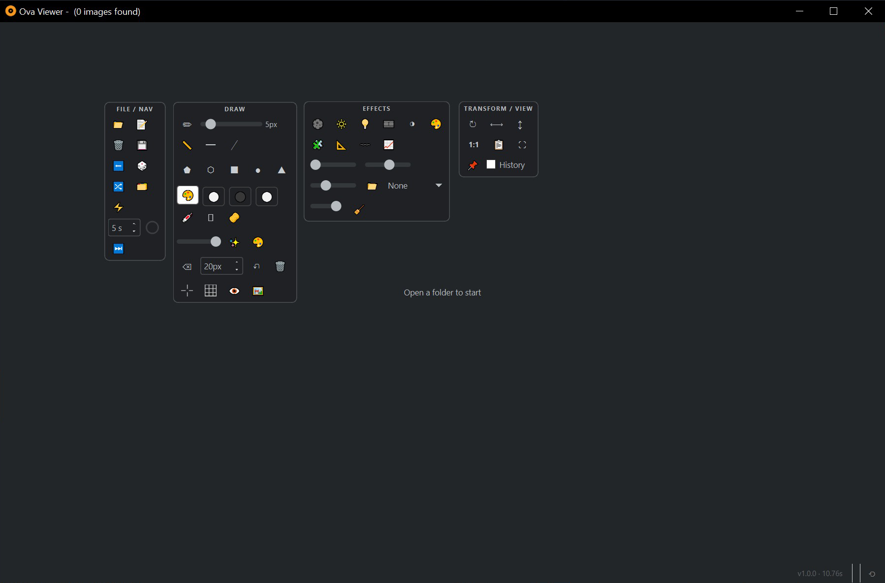

# Ova Viewer

A fast, feature-rich media viewer for Windows built with PySide6. View images, PDFs, EPUBs, comic archives (CBR/CBZ), animated GIFs, and videos in a single window — with a full annotation layer and non-destructive image enhancement stack.

---

## Recent Updates

- Added a ▦ thumbnail grid (**G**): opens instantly even on huge folders, loads only what is on screen (progress in the status bar), with a GRID panel for pictures per row, gap, justified rows, fit-all-on-screen, file names and GPU (OpenGL) drawing. Thumbnails are decoded in parallel and cached on disk.
- Added an eraser tool that removes annotations without touching the underlying image.
- Added live free-line preview while placing 2-click line annotations.
- Added posterize/value-filter controls for reducing images to N grayscale tones.
- Added Canny-based edge detection with OpenCV support and adjustable sensitivity.
- Added Object Groups — a cryptomatte-style pass that splits the image into objects and flattens each to its own local color.
- Added a File Types palette that filters browsing to the file types you check (e.g. only MP4 or GIF).
- Added autoplay-next so videos and animated GIFs advance to the following item when they finish.
- Moved Value Filter, Color Groups and Object Groups into their own floating panels, each with an Opacity slider that layers the effect over the original.
- Added dub audio: play a sibling audio file (clip.mp4 → clip.mp3) in place of a video's own soundtrack, kept in sync while seeking.
- Videos and animated GIFs now pause while the window is minimised and pick up again on restore.
- Edge Detection joined the panel treatment: one icon, with mode, sensitivity and line-opacity sliders in its own floating panel.
- Added a New sketch button — a blank mid-grey canvas with the free-draw tool armed, saved with the existing Save button.
- Added Form Lines — cross-contour line work that reads the subject’s form from its shading (contour, hatch and wrap modes).
- Merged the LINE / COLOR panel into DRAW: one panel, a row per job (mark, fill, colour, look, fix, view). Press **I** for the colour snap eyedropper.
- Added triangle fill (drag) and polygon fill (click corners, straight edges).
- Added WebP support: `.webp` pictures browse like any other image, and animated ones play like GIFs.
- Added a 🔁 loop toggle for videos and animated GIFs.
- Video timeline: click anywhere to jump there, drag to scrub, and hover to preview the frame at that moment.
- Fixed drawing on rotated pictures: at 90° / 270° clicks, brush strokes and the eraser landed away from the cursor on any non-square image.

## Features

**Viewing**
- 📁 Open any folder (including subfolders) via button or drag & drop
- 🖼️ Images (JPEG, PNG, BMP, WebP, JPEG 2000) · 📄 PDFs (single / 2-page / 3-page book spread) · 📚 EPUBs · 🗜️ CBR/CBZ comics · 🎞️ Animated GIFs and WebP · 🎬 Videos
- 🔍 Zoom & pan (mouse wheel + right-click drag)
- 🔄 Rotate, flip horizontal/vertical
- 🖥️ Fullscreen (F11) and minimal/frameless mode
- 🕒 Auto-advance timer with circular countdown overlay
- ⏭ **Autoplay next** — when a video or animated GIF finishes, move on to the next item automatically (holds the auto-advance countdown so a long clip is never cut short)
- 🔁 **Loop** — repeat the video or GIF on screen instead of stopping at the end. The opposite of autoplay-next, so switching one on switches the other off
- 🎵 **Dub audio** — if an audio file sits beside a video with the same name (`clip.mp4` → `clip.mp3`), play it instead of the video's own track, held in sync through seeking, stepping and pause. Off by default; toggled from the video controls
- ⏱ **Video timeline** — click anywhere on it to jump there, drag to scrub (including straight on from that click), and hover to see a thumbnail of the frame at that moment
- ▦ **Thumbnail grid** (**G**) — every item in the folder at a glance, PureRef-style. The default grid gives each item an equal square cell, so even a folder of tens of thousands of files opens instantly and you can jump anywhere; ▤ **justified rows** fill each row edge to edge instead (picture sizes are read once per folder and remembered, and thumbnails never shift once placed). Only what is on screen plus about a screen around it is loaded — a thin line along the bottom and the status bar show the percentage. Like a PureRef board, hold the right button and turn the wheel to zoom around the pointer, and right-drag to pan in any direction (flick to glide) — zooming in never loads more than the plain view. A floating GRID panel (bottom-right, collapsed) sets pictures per row, the gap, the layout, **fit all on screen**, file names and **GPU** drawing (OpenGL viewport, off at each start). Big cells (few per row) get sharper versions. Videos, PDFs/EPUBs and comics show their first frame or page. Thumbnails are cached in `%LOCALAPPDATA%\OvaViewer\thumbs` (1 GB cap, oldest evicted), so reopening a folder is instant; smooth with tens of thousands of files
- ⏮️ History navigation (back/forward through viewed images)
- 🔀 Random or alphabetical sorting
- 🗂 **File Types palette** — lists every file type found in the loaded folder with a checkbox and file count; uncheck a type to skip it while browsing (all types shown by default)

**Annotation**
- 📝 **New sketch** — one click opens a blank mid-grey canvas sized to the drawing area with the free-draw tool already active, for quick notes and thumbnails; save it with 💾 like any other view
- 📏 Vertical, horizontal, and free-angle line tools
- ⬟ Fill tools: **lasso** (drag an outline), **polygon** (click corners joined by straight edges; double-click, Enter or click the first corner to fill), **rectangle**, **ellipse** and **triangle** (drag out the shape)
- 🧽 Eraser tool for removing parts of line and free-draw annotations
- ✏️ Freehand draw with pressure-sensitive thickness (pen/stylus/tablet)
- 👀 Live rubber-band preview for free-angle line placement
- Undo, toggle visibility, clear all lines
- Save annotated view to file

**Color & Enhancement**
- 💉 **Color Snap eyedropper** (**I**) — hover to preview, click to pick a color from the image
- ✨ **Auto-extract palette** — extracts dominant colors into the floating palette panel
- 🎨 **Floating palette panel** — resizable, draggable, persists across tool switches; swatches organized by extraction session
- 🎞️ **CUBE LUT support** with GPU-accelerated (OpenCL) processing and adjustable strength
- ◑ **Posterize/value filter** — reduce images to 2-10 grayscale tones for value studies
- 🎨 **Color Groups** — reduce the whole image to N flat colors sampled from itself
- 🧩 **Object Groups** — cryptomatte-style: segments the image into objects and flattens each to its *own* local color, so two objects sharing a color stay separate. Local colors, local colors + outlines, or random ID colors; adjustable detail and minimum object size
- 🎚️ Each of these three effects lives in its own floating panel (one toolbar icon opens it, like Curves) with an **Opacity** slider, so the effect can be layered back over the original instead of being all-or-nothing
- 📐 **Edge detection** with Canny filtering, three looks (edges on dark, on white, or over the image), a sensitivity slider and an opacity slider that doubles as line transparency in overlay mode
- 〰️ **Form Lines** — cross-contour line work inferred from shading: **Contour** (iso-brightness lines wrapping the form like a topographic map), **Hatch** (pencil strokes flowing along the surface, denser in shadow), **Wrap** (sparse strokes drawn across the form). Density, surface-smoothing and opacity sliders; lower the opacity to draw the lines over the photo itself
- Grayscale, contrast, and gamma sliders with per-effect toggles

**Other**
- 🎨 Adaptive dark/light theme (follows Windows system setting)
- ⌨️ Full keyboard shortcut set (see [SHORTCUTS.md](SHORTCUTS.md))
- Copy current image to clipboard (📋)

---

## Installation

Requires **Python 3.15** (Windows). Dependencies go into a project-local
virtual environment (`.venv`), not the global Python:

```bat
git clone https://github.com/designOVAcz/ova-viewer.git
cd ova-viewer
py -3.15 -m venv .venv
.venv\Scripts\activate
python -m pip install -r requirements.txt
python main.py
```

Later sessions only need `.venv\Scripts\activate` (VS Code picks the venv up
automatically) — or skip activation and run `.venv\Scripts\python main.py`.
`pyopencl` (GPU LUT acceleration) is included; without a working OpenCL
driver the CPU path is used.

---

## Usage

1. Drag a folder into the app or click 📁 to open one
2. Navigate with **← →** or enable the auto-advance timer (**⚡**)
3. Annotate with the tools in the **DRAW** panel — brush, lines, fills, colour, eraser and view helpers all live there
4. Toggle **💉** (or press **I**) to pick colors from the image; use **✨** to auto-extract a palette
5. Load a `.cube` LUT file and adjust strength with the slider
6. Press **F11** for fullscreen, **Esc** to exit

---

## Build a Standalone Executable

Run `build_exe.bat` — it creates/updates `.venv`, installs
`requirements-dev.txt` (adds PyInstaller) and builds from `Ova Viewer.spec`.
By hand, with the venv active:

```bat
python -m pip install -r requirements-dev.txt
python -m PyInstaller --noconfirm "Ova Viewer.spec"
```

Output: `dist/Ova Viewer/Ova Viewer.exe` — keep the folder together (a
one-folder build starts ~4x faster than a one-file exe).

## Versioning

The version comes from **git tags** — there is no version number to edit.
Releases are annotated [SemVer](https://semver.org) tags; every commit in
between gets a unique version automatically:

| State | Version |
|---|---|
| exactly on tag `v1.2.0` | `1.2.0` |
| 3 commits after it | `1.2.0+3.gabc1234` |
| with uncommitted changes | `1.2.0+3.gabc1234.dirty` |

It shows in the status bar corner and in the exe's *Properties → Details*.
To release, tag and push (this repo has `push.followTags` on, so a plain
`git push` also sends new tags):

```bat
git tag -a v1.2.0 -m "Ova Viewer 1.2.0"
git push
```

Bump MAJOR for breaking changes, MINOR for new features, PATCH for fixes.

---

## Screenshot



---

## License

MIT License.

