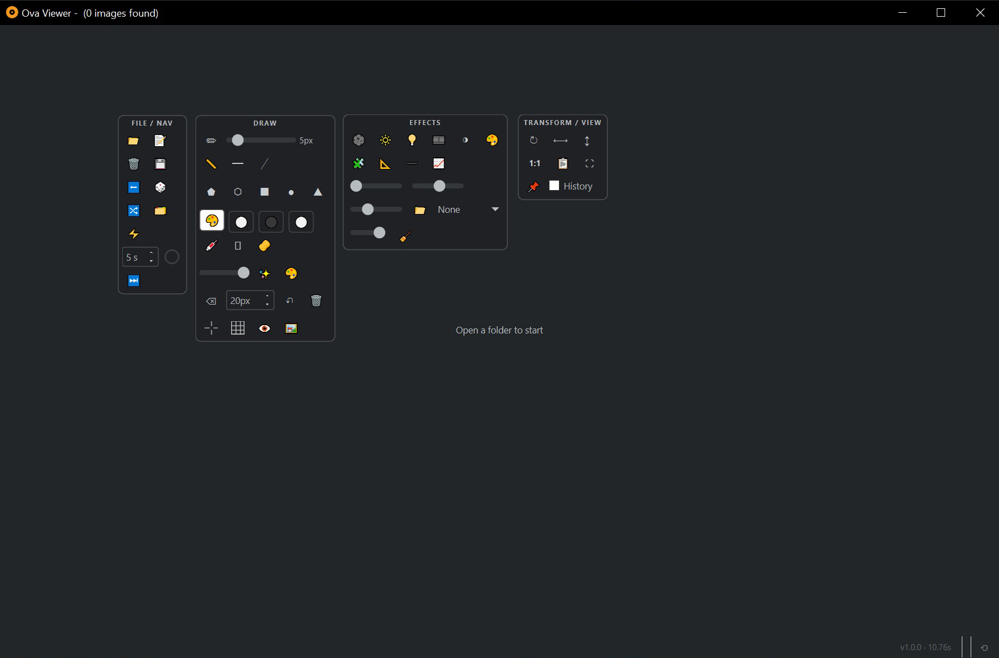

# Ova Viewer

A fast, feature-rich media viewer for Windows built with PySide6. View images, PDFs, EPUBs, comic archives (CBR/CBZ), animated GIFs, and videos in a single window — with a full annotation layer and non-destructive image enhancement stack.

---

## Recent Updates

- ◧ Studio: the effects (grayscale, contrast, LUT, value filter, colour groups …) now change only the picture on the right by default. The grey canvas and what you paint on it stay as painted, while you paint and after. Turn on ◧✨ in the Effects panel to put them over the canvas too; the choice is remembered.
- 💾 "🎨 Painting only" in ◧ Studio is saved on transparent, without the grey canvas.
- 🖌 Brush tips drawn as dark paint on transparent (many tip packs) now work as they are; before, they painted nothing.
- 🖌 Each brush mode (Paint, Blend, Smudge, History, Pick blend, Erase) keeps its own brush size, remembered between sessions.
- ✏ Turn the pen round: its eraser end switches the brush to 🧽 Erase (with Erase's size), the tip end back to the mode it was in.
- 📥 in 📚 Layers imports a PNG (or any picture) onto the selected layer, transparency kept: it lands in the middle of the canvas (◧ Studio) or the picture, ⬚ selected to move, scale and turn; Ctrl+Z takes it away.
- 🖌 New **Soft** brush tip, right after Round: a feathered round whose **Softness** slider (0 % a hard disc, 100 % all feather, like an airbrush) shows in the Brush panel while it's picked. Each stroke keeps the softness it was drawn with, and flat strokes come out as smooth capsules, with no seams.
- 📝 **New sketch** sets up for painting: 🖌 Brush snaps to the top left with 📚 Layers under it (docked; one that doesn't fit below starts the next column), the DRAW panel opens unfolded and snaps to the top right, and the 🎨 colour box closes. While ColorPenguin is connected, picking up the brush no longer pops the colour box open either.
- ⛰ **Impasto** (Layers panel → ⛰ Impasto, per layer): the layer's paint is lit as thick relief, like Rebelle's bristle impasto. You get grooves along the bristles, a raised rim at stroke edges, embossed tip texture and a wet highlight. Sliders: Depth, Grooves, Edges, Edge px, Light (direction) and Gloss. The height comes from the paint itself, and the lighting runs as one fused OpenCL kernel on the GPU (~50 ms for a full screen, with a CPU fallback). It's cached per layer and only redone when the paint, the settings or the zoom change. While zooming or panning the lit image is moved, and saving at 2× / 4× keeps the same relief.
- 🎨 **F8** picks the colour under the mouse anywhere on screen, in other windows too, as the brush colour. This is how ColorPenguin's **KB** sync works without Rebelle: set its Sync mode to KB, Program to Ova Viewer and Hotkey to F8.
- 🐧 **ColorPenguin sync**: with ColorPenguin's sync set to *Rebelle*, the colour you pick there becomes Ova Viewer's brush colour (the colour button, picker and cursor rim follow; mid-stroke it waits for the pen to lift). Ova answers on Rebelle's local WebSocket port (127.0.0.1:8265, this computer only). While Rebelle itself is running with its WebSocket server, the colours stay Rebelle's and Ova takes over once it closes. On/off: right-click → 🐧 Colours from ColorPenguin.
- 🖐 Wacom / touchpad two-finger pan works at any zoom, 100 % and below too, in the normal view as well as in ◧ Studio. In the normal view a mouse wheel still turns to the next / previous picture (which opens centred), and in Studio it still zooms.
- ◧ Studio: the right button pans at any zoom (100 % and below too); a right click without dragging still opens the menu. Studio opens the DRAW panel, unfolded and snapped to the top-right corner, and puts it back as it was when you leave.
- 🛡 The mouse wheel and middle click never change image while something is drawn (any layer, any tool, even with every tool off) or in ◧ Studio: the wheel zooms instead. ← → still change image, and that clears the drawing.
- The extra "PDF / VIDEO" panel no longer appears for songs and videos (it repeated the bar on the picture). For a PDF / EPUB / comic it is now "PAGES": it comes up reliably, ⟲ Reset stacks it with the other panels, and its place is remembered.
- 💉 The Palette panel shows at most 10 swatches side by side; longer palettes wrap onto new lines, in columns.
- 🧊 New brush mode **Push (liquify)** (key 8): moves the pixels under the brush along with it as a mass, so lines bend and get shoved along, never blurred. **Strength** sets how far the paint follows the brush. **Ice** sets how unevenly neighbouring pixels move: 0 % is a clean liquify push, higher cracks the paint into icy fragments like HeavyPaint's Blur Ice. Textured tips break it up more, and the ends are feathered.
- 🌊 New brush mode **Smear** (key 7): the tip works like a row of hairs, one every half pixel across the stroke. Each hair grabs paint that stands out (a line, a speck, an edge) and carries it on whole, so things are transported in thin, sharp streaks (HeavyPaint style) instead of fading or blurring. Its own sliders: **Drag** (how far a load is carried, a few px up to ~400 px), **Grab** (how firmly hairs pick paint up; 0 % only blends), **Edge** (how much something must stand out: low picks up faint detail too, high only strong lines) and **Blur** (an extra soft mix; 0 % = none). A textured tip gives stronger and weaker hairs; Opacity sets how much shows. Both ends of a smear are feathered (faded over half the brush width) instead of stopping in a straight cut. Paint is really transported: what a hair grabs is lifted off its place (the ground shows there) and laid further along, so particles and lines move instead of being copied.
- 💾 Saving a part of the sheet (2× / 4×) shows real progress: the line at the bottom grows with the picture, each mark laid again and the PNG written, with the percentage in the status bar.
- ✏ B picks up the freehand brush. The brush cursor has a slim, light rim in the current colour (steady, no blinking), so it is easy to find on grey.
- 🖌 The Brush panel has an Opacity slider under Size, the twin of the DRAW panel's: moving either moves both.
- 📚 Layer blend modes (Overlay, Multiply …) now work with 🖼 Picture hidden too: layers blend with the layers under them, then lie on the background as they are.
- ♪ A song playing in the G grid goes on in the viewer from the same point when you double-click it or close the grid with G (it no longer starts over, or stops).
- ♪ Music keeps playing while the window is minimised, and behind the G grid while you pick the next song; it stops only when another song starts.
- Cleaner flat strokes (Paint: flat, no build-up). Round a curve, the pieces of the stroke now meet along the line halfway between their directions, so no square corner pokes out: the small ticks along both edges of curves are gone. A stroke that turns back starts again from the tip's own ragged edge instead of a hard square slab. Colour jitter blends in along the stroke like wet paint instead of starting as a hard band across it.
- ♪ Music: MP3, FLAC, WAV, M4A, AAC, OGG, Opus and WMA open like videos, with the same timeline, volume, loop and autoplay-next, and a "now playing" card showing the cover art, title, artist and album from the file's tags (otherwise its name). Music starts with sound (videos still start muted), and each keeps its own mute setting. In the thumbnail grid, songs are drawn as title rows, one per row like a list, with the file type on the right. Click one to play it right there, with a progress line along the bottom; with the slideshow's autoplay-next it moves on to the next item at the end. A video's own soundtrack (`clip.mp3` beside `clip.mp4`) stays with the video and isn't listed as a song. The 🗂 File Types panel can show only the music, or hide it.
- Fixed the round brush's opacity: a stroke at 10 % came out almost opaque, because it was drawn as many short pieces whose overlaps built the colour up. Now the whole stroke is drawn once and laid down at the chosen opacity, like paint: 10 % looks like 10 % (white on mid-grey: 140 instead of 210–251), and a stroke crossing itself stays even. Same while drawing and after.
- Grayscale, contrast and gamma respond much faster. Contrast and gamma are worked out once per setting as a lookup table and applied in one pass (12–15 ms instead of 20–100 ms on a 2048 px picture, same result). A slider drag now redraws only with the newest value, so the picture no longer catches up long after you let go. Grayscale between 0 and 100 % now stays opaque; before, it left the picture slightly see-through and darker over the background.
- ◧ Studio opens the 🖌 Brush panel with it, and closes it again when Studio goes off (if Studio was what opened it).
- 👁 in the Draw panel now hides only the guides: vertical and horizontal ruler lines, free lines and polylines. What you painted (brush strokes, fills, snapshots) stays on screen. Picking a guide tool shows the guides again. To hide a whole drawing, untick its layer in 📚.
- ◧ Studio guides: vertical ruler lines, free lines and polylines drawn on the picture also show at the same place on the grey canvas, to measure against while you paint. They follow the original when it's moved, undone or hidden, and saves leave the copies out. Horizontal ruler lines already span both sides.
- ◧ Studio 💾 "Picture only" with 🖼 Picture unticked in 📚 saves just what is drawn over it, on a transparent background, with no grey paper behind.
- ✏ Free draw shows the stroke much sooner. While you paint, only the few pixels the pen just touched are repainted (about 0.4 ms), not the whole window (14–18 ms on a 1.5× display), and each frame goes out as soon as the pen events in hand are painted instead of after a fixed 8 ms wait. Works for every brush, any size, any layer opacity or blend; strokes under effects or 🧽 Erase keep the full redraw.
- 🎨 Color, 🖌 Brush and 📚 Layers now open docked down the left edge of the window, in that order (one that doesn't fit below starts a new column to the right). Docked, they follow the window when it moves or resizes, and close up when one is shut. Drag one away to place it anywhere; drop it back near its spot and it docks again. ⟲ (reset tool panels, bottom-left) closes all three, and they open docked again.
- 🪮 Rake brush tip (in 🖌, after Bristles): a row of tines that lays parallel lines. It works in every brush mode: Paint draws the lines, Smudge combs each tine's own colour through the paint, Blend mixes, Erase scratches parallel gaps. Its own sliders set the number of tines (2–40), how thick each one is, and Wobble (0 % for ruled lines, more for a worn, uneven rake). The row turns with the stroke (or the pen's tilt) and is the brush size wide.
- ⬚ Select + transform (**V**): lasso marks on a layer, then move, scale (corners) or turn them (outside the frame, Shift for 15° steps). Enter applies, Esc cancels, Ctrl+Z undoes. Strokes are data, so they're painted again at the new size and stay sharp.
- 💾 in ◧ Studio saves the painting only, the picture only, or both, at 1×, 2× or 4×. Each size is painted again at that resolution, not blown up (right-click 💾 for the same choices outside Studio).
- Drawing feels lighter: Ctrl+Z on a drawing of 30 textured strokes went from ~1.2 s to ~25 ms (the layer keeps its image from before each of the last strokes, so undo is a copy instead of painting everything again). A quarter turn or flip with a drawing went from ~0.9 s to ~40 ms (the drawing turns at once and is painted again in the background). Changing the brush size or colour no longer repaints the whole drawing at the next stroke, and a big Spray or build-up stroke is kept as you drew it instead of being laid again when you let go (~0.5 s → ~35 ms). Anything that still takes a while (heavy effects such as object groups, undoing far back right after a zoom) shows the amber progress line at the bottom of the window.
- ⌫ in the Draw panel now erases with the brush (🧽 Erase, the 6th brush mode, key **6**): the stroke uses the brush's own tip, size, pen pressure and opacity, so soft and textured tips rub out softly or with their grain. As before, it only touches the selected layer, never the picture. `Ctrl+Z` undoes it, and clicking ⌫ again returns the brush to the mode it was in.
- Brush modes (🖍 / 💧 / 👆 next to 🖌): Paint as before, Blend mixes the brush colour with what is under it, and Smudge drags the colours under the pen along. They work with Round and every texture. Blend and Smudge mix colours like paint by default (blue + yellow = green, not grey); the Brush panel's Mix switch sets it back to light mixing.
- 🖌 Textured brushes for free draw: load PNG brush tips (a folder at once or single files), and each stamp turns with the pen's tilt (or the stroke direction), grows and fades with pressure, and can jitter its hue, saturation and value per stamp, per stroke or across the tip (streaks: every bristle its own colour, running on along the stroke, as in HeavyPaint's oil brushes; with Blend / Smudge each streak mixes or drags the colour under its own spot). A built-in Bristles tip comes with it, and a Dust (airbrush) tip: a spray of specks, with Scatter, Size ± and colour jitter per speck (particles). The Spray tip draws its specks procedurally, as dots at full resolution, with a cloud up to 20x the brush size. Round stays the default. Strokes are flat by default, as in HeavyPaint: the tip is dragged along like paint and doesn't build up on itself, so its grain and gaps run on as streaks; the cursor shows the tip's outline at the brush size, turned with the pen.
- 📸 Snapshot to layer: copies what is on screen (effects, marks, background) onto a new layer, the same view 💾 saves. Turn an effect off afterwards and compare, blend the snapshot with Multiply / Overlay, or erase parts of it.
- In the thumbnail grid, moving onto a GIF or video with the arrow keys plays it, just like clicking it; with a picture framed, the arrows move the frame along to the next one.
- `Delete` works in the thumbnail grid: the selected file goes to the Recycle Bin and the next one takes its place. Folders now open in alphabetical order by default (🔀 for random). A video or GIF that was just playing can now be deleted straight away; before, Windows could refuse because the file was still open.
- You can draw on a paused video or GIF: marks used to vanish the moment you let go. Pause, draw with any tool, and 💾 saves the frame with your notes. They stay on screen if you play on, until you move to another file. 🖼 now hides the video or GIF too, leaving only your notes on the background.
- Finishing a line no longer gets slower as a drawing grows: each new line paints only itself, starting one no longer re-reads the picture, and effects are not recalculated after it. Redrawing after a zoom or pan is about 4× faster too.
- The background around the picture is now a canvas: every drawing tool works on it, so you can write notes beside the picture, and 💾 saves them with it. Pick its colour in the 📚 Layers panel (black by default); the colour is remembered and also shows behind a hidden picture.
- Added 📚 layers (**L**) for everything you draw: each layer has its own opacity and blend mode (Multiply, Screen, Overlay and more) that you can change at any time after drawing, can be hidden, renamed and reordered, and has its own eraser and Ctrl+Z. The eraser now only touches the selected layer. As before, marks are cleared when you move to another picture; the layers and their settings stay for the next one, until you close the app.
- Added a ✂ crop tool (**C**): drag a frame, adjust its edges or move it, then **Enter** or double-click — what is inside stays. It is cut from the file at full resolution, with rotation, flips and drawn marks included, and saved as a new picture in Downloads right after the original in the list. The original file is never changed.
- Film playback: the **s / fps** button next to the ⚡ seconds switches the slideshow to frames per second (1–60; scrolling steps 12, 15, 24, 25, 30 …). ⚡ then plays the folder's pictures in alphabetical order as a film, decoding the next frames ahead at screen size on background threads. 🔁 loops it, otherwise it stops on the last frame; pause (click the ring) shows the frame at full quality with every effect. Random order switches back to seconds.
- Added a 〽 polyline tool: click corners like polygon fill, but it draws straight lines instead of filling — double-click / Enter for an open line, click the first corner to close it.
- ▣ in the status bar hides / shows all tool panels (frame and status bar stay); the log moved to the right-click menu.
- `Tab` starts / stops the slideshow, and a running slideshow now carries on when you switch between the viewer and the grid (from the same picture, or the one you double-click).
- Grid slideshow follows ⏭ autoplay-next (a GIF or video plays to its end before moving on), and while the camera flies to a picture the surrounding ones fade gently, so the one in focus stands out.
- The thumbnail grid now shows the pages of an open PDF, EPUB or CBR/CBZ: click to frame a page, double-click to go to it, ▶ to fly through them; 📄 switches back to the whole folder.
- Added a ▶ slideshow to the thumbnail grid: the camera flies from picture to picture, framing each one (GIFs and videos play), with the viewer's ⚡ seconds and 🔀 order.
- Added ➕ add mode: opening or dropping folders adds them to the current list instead of replacing it (or hold `Ctrl` for a one-off add).
- Added a ▦ thumbnail grid (**G**): opens instantly even on huge folders, loads only what is on screen (progress in the status bar), with a GRID panel for pictures per row, gap, justified rows, fit-all-on-screen, file names and GPU (OpenGL) drawing. Thumbnails are decoded in parallel and cached on disk.
- Added an eraser tool that removes annotations without touching the underlying image.
- Added live free-line preview while placing 2-click line annotations.
- Added posterize/value-filter controls for reducing images to N grayscale tones.
- Added Canny-based edge detection with OpenCV support and adjustable sensitivity.
- Added Object Groups — a cryptomatte-style pass that splits the image into objects and flattens each to its own local color.
- Added a File Types palette that filters browsing to the file types you check (e.g. only MP4 or GIF).
- Added autoplay-next so videos and animated GIFs advance to the following item when they finish.
- Moved Value Filter, Color Groups and Object Groups into their own floating panels, each with an Opacity slider that layers the effect over the original.
- Added dub audio: play a sibling audio file (clip.mp4 → clip.mp3) in place of a video's own soundtrack, kept in sync while seeking.
- Videos and animated GIFs now pause while the window is minimised and pick up again on restore.
- Edge Detection joined the panel treatment: one icon, with mode, sensitivity and line-opacity sliders in its own floating panel.
- Added a New sketch button — a blank mid-grey canvas with the free-draw tool armed, saved with the existing Save button.
- Added Form Lines — cross-contour line work that reads the subject’s form from its shading (contour, hatch and wrap modes).
- Merged the LINE / COLOR panel into DRAW: one panel, a row per job (mark, fill, colour, look, fix, view). Press **I** for the colour snap eyedropper.
- Added triangle fill (drag) and polygon fill (click corners, straight edges).
- Added WebP support: `.webp` pictures browse like any other image, and animated ones play like GIFs.
- Added a 🔁 loop toggle for videos and animated GIFs.
- Video timeline: click anywhere to jump there, drag to scrub, and hover to preview the frame at that moment.
- Fixed drawing on rotated pictures: at 90° / 270° clicks, brush strokes and the eraser landed away from the cursor on any non-square image.

## Features

**Viewing**
- 📁 Open any folder (including subfolders) via button or drag & drop — the 📁 dialog takes several folders at once (Ctrl/Shift-click them, then *Select Folder*)
- ➕ **Add mode** — opened or dropped folders and files join the current list instead of replacing it (hold `Ctrl` while dropping or clicking 📁 to add just once); the picture on screen stays and duplicates are skipped
- 🖼️ Images (JPEG, PNG, BMP, WebP, JPEG 2000) · 📄 PDFs (single / 2-page / 3-page book spread) · 📚 EPUBs · 🗜️ CBR/CBZ comics · 🎞️ Animated GIFs and WebP · 🎬 Videos
- 🔍 Zoom & pan (mouse wheel + right-click drag)
- 🔄 Rotate, flip horizontal/vertical
- 🖥️ Fullscreen (F11) and minimal/frameless mode
- 🕒 Auto-advance timer with circular countdown overlay
- ⏭ **Autoplay next** — when a video or animated GIF finishes, move on to the next item automatically (holds the auto-advance countdown so a long clip is never cut short)
- 🔁 **Loop** — repeat the video or GIF on screen instead of stopping at the end. The opposite of autoplay-next, so switching one on switches the other off
- 🎵 **Dub audio** — if an audio file sits beside a video with the same name (`clip.mp4` → `clip.mp3`), play it instead of the video's own track, held in sync through seeking, stepping and pause. Off by default; toggled from the video controls
- ⏱ **Video timeline** — click anywhere on it to jump there, drag to scrub (including straight on from that click), and hover to see a thumbnail of the frame at that moment
- ▦ **Thumbnail grid** (**G**) — every item in the folder at a glance, PureRef-style. The default grid gives each item an equal square cell, so even a folder of tens of thousands of files opens instantly and you can jump anywhere; ▤ **justified rows** fill each row edge to edge instead (picture sizes are read once per folder and remembered, and thumbnails never shift once placed). Only what is on screen plus about a screen around it is loaded — a thin line along the bottom and the status bar show the percentage. Like a PureRef board, hold the right button and turn the wheel to zoom around the pointer, and right-drag to pan in any direction (flick to glide) — zooming in never loads more than the plain view. A floating GRID panel (bottom-right, collapsed) sets pictures per row, the gap, the layout, **fit all on screen**, file names and **GPU** drawing (OpenGL viewport, off at each start). Big cells (few per row) get sharper versions. Videos, PDFs/EPUBs and comics show their first frame or page. Thumbnails are cached in `%LOCALAPPDATA%\OvaViewer\thumbs` (1 GB cap, oldest evicted), so reopening a folder is instant; smooth with tens of thousands of files
- ⏮️ History navigation (back/forward through viewed images)
- 🔀 Alphabetical order by default, or random
- 🗂 **File Types palette** — lists every file type found in the loaded folder with a checkbox and file count; uncheck a type to skip it while browsing (all types shown by default)

**Annotation**
- 📝 **New sketch** — one click opens a blank mid-grey canvas sized to the drawing area with the free-draw tool already active, for quick notes and thumbnails; save it with 💾 like any other view
- ◧ **Studio** — side-by-side copying: a blank mid-grey canvas the size of the picture appears on its left with the brush ready, so you paint what you see on the right. Zoom, rotation, effects and layers work on both halves together (a value study filters your painting and the reference alike); 💾 saves them side by side. Stays on from picture to picture until switched off
- 📏 Vertical, horizontal, and free-angle line tools
- ⬟ Fill tools: **lasso** (drag an outline), **polygon** (click corners joined by straight edges; double-click, Enter or click the first corner to fill), **rectangle**, **ellipse** and **triangle** (drag out the shape)
- 〽 **Polyline** — the polygon tool without the fill: click corners joined by straight lines in the current colour and brush size; double-click / Enter finishes an open line, clicking the first corner closes it
- 🧽 Erase with any brush (⌫): removes parts of what is drawn on the selected layer, never the picture
- ✏️ Freehand draw with pressure-sensitive thickness (pen/stylus/tablet)
- 👀 Live rubber-band preview for free-angle line placement
- Undo, toggle visibility, clear all lines
- Save annotated view to file

**Color & Enhancement**
- 💉 **Color Snap eyedropper** (**I**) — hover to preview, click to pick a color from the image
- ✨ **Auto-extract palette** — extracts dominant colors into the floating palette panel
- 🎨 **Floating palette panel** — resizable, draggable, persists across tool switches; swatches organized by extraction session
- 🎞️ **CUBE LUT support** with GPU-accelerated (OpenCL) processing and adjustable strength
- ◑ **Posterize/value filter** — reduce images to 2-10 grayscale tones for value studies
- 🎨 **Color Groups** — reduce the whole image to N flat colors sampled from itself
- 🧩 **Object Groups** — cryptomatte-style: segments the image into objects and flattens each to its *own* local color, so two objects sharing a color stay separate. Local colors, local colors + outlines, or random ID colors; adjustable detail and minimum object size
- 🎚️ Each of these three effects lives in its own floating panel (one toolbar icon opens it, like Curves) with an **Opacity** slider, so the effect can be layered back over the original instead of being all-or-nothing
- 📐 **Edge detection** with Canny filtering, three looks (edges on dark, on white, or over the image), a sensitivity slider and an opacity slider that doubles as line transparency in overlay mode
- 〰️ **Form Lines** — cross-contour line work inferred from shading: **Contour** (iso-brightness lines wrapping the form like a topographic map), **Hatch** (pencil strokes flowing along the surface, denser in shadow), **Wrap** (sparse strokes drawn across the form). Density, surface-smoothing and opacity sliders; lower the opacity to draw the lines over the photo itself
- Grayscale, contrast, and gamma sliders with per-effect toggles

**Other**
- 🎨 Adaptive dark/light theme (follows Windows system setting)
- ⌨️ Full keyboard shortcut set (see [SHORTCUTS.md](SHORTCUTS.md))
- Copy current image to clipboard (📋)

---

## Installation

Requires **Python 3.15** (Windows). Dependencies go into a project-local
virtual environment (`.venv`), not the global Python:

```bat
git clone https://github.com/designOVAcz/ova-viewer.git
cd ova-viewer
py -3.15 -m venv .venv
.venv\Scripts\activate
python -m pip install -r requirements.txt
python main.py
```

Later sessions only need `.venv\Scripts\activate` (VS Code picks the venv up
automatically) — or skip activation and run `.venv\Scripts\python main.py`.
`pyopencl` (GPU LUT acceleration) is included; without a working OpenCL
driver the CPU path is used.

---

## Usage

1. Drag a folder into the app or click 📁 to open one
2. Navigate with **← →** or enable the auto-advance timer (**⚡**)
3. Annotate with the tools in the **DRAW** panel — brush, lines, fills, colour, eraser and view helpers all live there
4. Toggle **💉** (or press **I**) to pick colors from the image; use **✨** to auto-extract a palette
5. Load a `.cube` LUT file and adjust strength with the slider
6. Press **F11** for fullscreen, **Esc** to exit

---

## Build a Standalone Executable

Run `build_exe.bat` — it creates/updates `.venv`, installs
`requirements-dev.txt` (adds PyInstaller) and builds from `Ova Viewer.spec`.
By hand, with the venv active:

```bat
python -m pip install -r requirements-dev.txt
python -m PyInstaller --noconfirm "Ova Viewer.spec"
```

Output: `dist/Ova Viewer/Ova Viewer.exe` — keep the folder together (a
one-folder build starts ~4x faster than a one-file exe).

## Versioning

The version comes from **git tags** — there is no version number to edit.
Releases are annotated [SemVer](https://semver.org) tags; every commit in
between gets a unique version automatically:

| State | Version |
|---|---|
| exactly on tag `v1.2.0` | `1.2.0` |
| 3 commits after it | `1.2.0+3.gabc1234` |
| with uncommitted changes | `1.2.0+3.gabc1234.dirty` |

It shows in the status bar corner and in the exe's *Properties → Details*.
To release, tag and push (this repo has `push.followTags` on, so a plain
`git push` also sends new tags):

```bat
git tag -a v1.2.0 -m "Ova Viewer 1.2.0"
git push
```

Bump MAJOR for breaking changes, MINOR for new features, PATCH for fixes.

---

## Screenshot



---

## License

MIT License.

