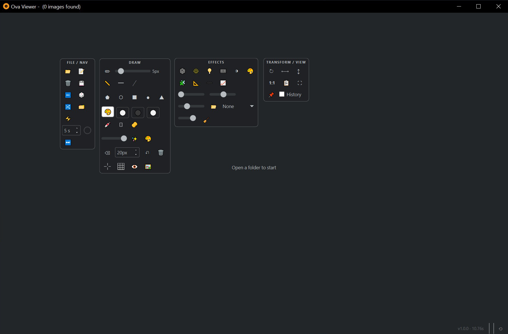

# Ova Viewer

A fast media viewer and painting companion for Windows, built with PySide6. Images, PDFs, EPUBs, comics, GIFs, videos and music in one window, with layered painting tools and a non-destructive effects stack.

---

## Features

**Viewing**
- 🖼 Images (JPEG, PNG, BMP, WebP, JPEG 2000), 📄 PDF (book spreads), 📚 EPUB, 🗜 CBR/CBZ, 🎞 GIF/WebP animations, 🎬 video
- ▦ Thumbnail grid (**G**): instant on huge folders, zoom and pan like PureRef, with a fly-through slideshow
- ⚡ Slideshow and film playback (seconds or fps), ⏭ autoplay-next, 🔁 loop. Videos: ← → seek, ↑ ↓ previous / next clip
- 🔍 Zoom, pan, rotate, flip, fullscreen: drawn on the GPU while the view moves, with each layer kept as one picture-resolution image, so they are instant even over a big painting. ⟲ shows the real size (100 %), click again to fit. Two-finger Wacom / touchpad pan works at any zoom
- ➕ Add mode for combining folders, 🗂 file-type filter, history, alphabetical or random order

**Music**
- ♪ MP3, FLAC, WAV, M4A, AAC, OGG, Opus, WMA with cover art and tags
- Song list in the grid with track lengths. Playback continues while minimised and while you browse

**Painting**
- ✏ Freehand brush (**B**) with pen pressure, tilt and the pen's eraser end
- 🖌 Textured brush tips (load PNG packs), plus built-in Round, Soft (adjustable softness), Bristles, Rake, Dust and Spray
- Brush modes: Paint, Blend, Smudge, History, Pick blend, Erase, 🌊 **Smear** (hair-style transport of paint) and 🧊 **Push** (liquify, with an "ice" crack option)
- Lines, polylines, lasso / polygon / shape fills, ⬚ select and transform, ✂ crop
- Lines are paint (brushes smudge and blend them) or guides drawn over it. In a brush mode other than Paint, the line tools run the brush along the line, and the shape tools run it over the whole shape, kept inside it (a lasso in Blend softens just that area; in Erase it cuts it out)
- 🌈 **Gradient**: linear or radial, the pen colour fading out or into a second colour, mixed in OKLab and dithered (no banding). A guide line shows where it runs while you drag (**Shift**: 15° steps). Shapes can fill with it too. On a Multiply / Overlay layer it shades or lights the painting
- 📝 New sketch and ◧ **Studio**: a grey canvas beside the picture for copying from reference

**Layers**
- 📚 Layers (**L**) with opacity, blend modes, visibility and import of PNGs
- ⛰ **Impasto**: per-layer paint relief (grooves, raised edges, gloss), lit on the GPU
- 📸 Snapshot to layer. Undo per layer

**Colour**
- 💉 Eyedropper (**I**) with a live preview, a palette panel (3 rows) and auto-extract
- A **second colour** beside the pen colour (as a paint program's background colour): the 🌈 gradient's other end. **Alt+click** a swatch or with the eyedropper to set it, **X** swaps the two
- 🟥 A floating, resizable swatch of the current colour. **F8** picks a colour from anywhere on screen

**Effects** (non-destructive)
- Grayscale, contrast, gamma, curves, 🎞 CUBE LUTs (GPU)
- Value filter, colour groups, object groups, edge detection, form lines, each with its own opacity

**Saving**
- 💾 The view, the painting only (transparent) or both, at 1×, 2× or 4×, painted again at full resolution
- 💼 Projects (`.ova`, **Ctrl+S**): the picture, Studio / sketch mode, every layer and mark, the palette and the view in one file. Open it later and carry on painting, with undo

See [SHORTCUTS.md](SHORTCUTS.md) for keyboard shortcuts.

---

## Installation

Requires **Python 3.15** on Windows.

```bat
git clone https://github.com/designOVAcz/ova-viewer.git
cd ova-viewer
py -3.15 -m venv .venv
.venv\Scripts\activate
python -m pip install -r requirements.txt
python main.py
```

GPU features use OpenCL (`pyopencl`). Without a working driver, the CPU is used instead.

## Build an executable

Run `build_exe.bat`. The output is `dist/Ova Viewer/Ova Viewer.exe` (keep the folder together).

## Versioning

The version comes from git tags (SemVer, e.g. `v1.2.0`). Commits after a tag get `1.2.0+3.gabc1234`. It shows in the status bar and in the exe's properties.

---

## Screenshot



## License

MIT License.
